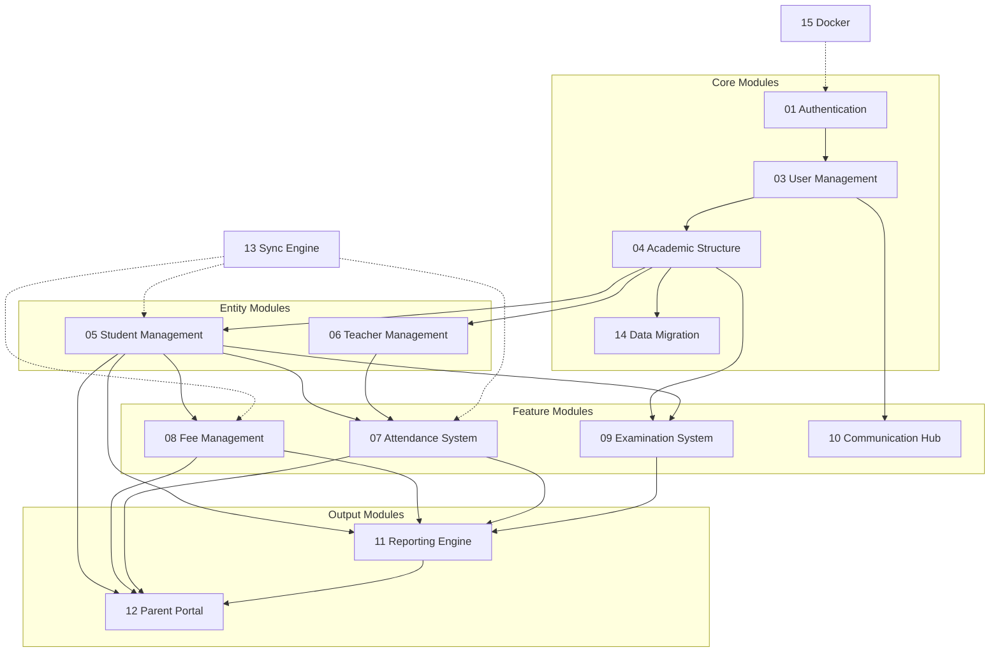

# 📋 School ERP - Master Development Roadmap

> **Purpose**: This document serves as the master index and development sequence for the School ERP system. Each module is designed to be built in order, with clear dependencies.

---

## 🎯 Project Goals

### Phase 1: Single-School Deployment (Current Focus)
1. Build a **complete school ERP** for a single school
2. Provide **4 user panels**: Admin (Filament), Teacher, Payment, Parent Portal
3. Integrate **biometric attendance** for teachers (ZKTeco/eSSL)
4. Support **local server deployment** via Docker
5. Enable **data import** from existing databases/Excel

### Phase 2: Future Enhancements
- Multi-tenant architecture for SaaS deployment
- Real-time sync between local and cloud
- Mobile apps (React Native)

---

## 🏗️ Architecture Overview

```
┌─────────────────────────────────────────────────────────────────────┐
│                       TECHNOLOGY STACK                               │
├─────────────────────────────────────────────────────────────────────┤
│  FRONTEND                          │  BACKEND                        │
│  ─────────                         │  ───────                        │
│  • Next.js 14 (React)              │  • Laravel 11 (PHP 8.3)         │
│  • TypeScript                      │  • Filament 3 (Admin Panel)     │
│  • TailwindCSS                     │  • Laravel Sanctum (API Auth)   │
│  • ShadCN UI Components            │  • Spatie Packages              │
├─────────────────────────────────────────────────────────────────────┤
│  DATABASE                          │  SERVICES                       │
│  ────────                          │  ────────                       │
│  • PostgreSQL 16 (Primary)         │  • Redis (Cache/Queue)          │
│  • SQLite (Desktop Offline)        │  • Twilio/MSG91 (SMS)           │
│  • Redis (Sessions)                │  • Razorpay (Payments)          │
└─────────────────────────────────────────────────────────────────────┘
```

---

## 📦 Module Index

> 🎯 **Current Focus: Single-School Deployment** - Multi-tenancy deferred to Phase 2

| # | Module | Priority | Backend | Frontend | Dependencies |
|---|--------|----------|---------|----------|--------------|
| 01 | [Authentication](./01-authentication.md) | 🔴 Critical | ✅ | ✅ | None |
| ~~02~~ | ~~[Multi-Tenancy](./02-multi-tenancy.md)~~ | ⏸️ Deferred | - | - | *Future Phase* |
| 03 | [User Management](./03-user-management.md) | 🔴 Critical | ✅ | ✅ | Auth |
| 04 | [Academic Structure](./04-academic-structure.md) | 🔴 Critical | ✅ | ✅ | Users |
| 05 | [Student Management](./05-student-management.md) | 🔴 Critical | ✅ | ✅ | Academic |
| 06 | [Teacher Management](./06-teacher-management.md) | 🔴 Critical | ✅ | ✅ | Academic |
| 07 | [Attendance System](./07-attendance-system.md) | 🟡 High | ✅ | ✅ | Students, Teachers |
| 08 | [Fee Management](./08-fee-management.md) | 🟡 High | ✅ | ✅ | Students |
| 09 | [Examination System](./09-examination-system.md) | 🟡 High | ✅ | ✅ | Academic, Students |
| 10 | [Communication Hub](./10-communication-hub.md) | 🟢 Medium | ✅ | ✅ | Users |
| 11 | [Reporting Engine](./11-reporting-engine.md) | 🟢 Medium | ✅ | ✅ | All Data Modules |
| 12 | [Parent Portal](./12-parent-portal.md) | 🟢 Medium | ✅ | ✅ | Students, Fees, Attendance |
| 13 | [Sync Engine](./13-sync-engine.md) | 🟡 High | ✅ | ✅ | All Modules |
| **14** | [**Data Migration**](./14-data-migration.md) | 🔴 Critical | ✅ | ✅ | Academic Structure |
| **15** | [**Docker Deployment**](./15-docker-deployment.md) | 🔴 Critical | ✅ | - | All Modules |

> **📥 Module 14 - Data Migration** enables hassle-free data import from existing databases or Excel files.
> **🐳 Module 15 - Docker** provides self-hosted deployment for schools.

---

## 📅 Development Phases

### Phase 1: Foundation (Weeks 1-3)
```
┌─────────────────────────────────────────────────────────────┐
│  WEEK 1-2: Backend Setup                                     │
│  ─────────────────────                                       │
│  • Laravel project initialization                            │
│  • PostgreSQL database setup                                 │
│  • Authentication system (Sanctum)                           │
│  • Base migrations for core tables                           │
│  • Filament admin panel setup                                │
├─────────────────────────────────────────────────────────────┤
│  WEEK 2-3: Frontend Setup                                    │
│  ────────────────────────                                    │
│  • Next.js project initialization                            │
│  • TypeScript configuration                                  │
│  • TailwindCSS + ShadCN UI setup                             │
│  • Auth context and protected routes                         │
│  • API client configuration                                  │
│  • Data Migration/Import UI (Module 14)                      │
└─────────────────────────────────────────────────────────────┘
```

### Phase 2: Core Modules (Weeks 4-8)
```
┌─────────────────────────────────────────────────────────────┐
│  WEEK 4-5: User & Academic Management                        │
│  ────────────────────────────────────                        │
│  • Filament admin panel for school admin                     │
│  • User management (staff creation, roles)                   │
│  • Class/Section/Subject CRUD                                │
│  • Academic year configuration                               │
├─────────────────────────────────────────────────────────────┤
│  WEEK 6-7: Student Module                                    │
│  ────────────────────────                                    │
│  • Student registration with all fields                      │
│  • Guardian information linking                              │
│  • Class assignment and roll numbers                         │
│  • Bulk import via Excel                                     │
│  • Student ID card generation                                │
├─────────────────────────────────────────────────────────────┤
│  WEEK 8: Teacher Module                                      │
│  ───────────────────────                                     │
│  • Teacher registration                                      │
│  • Subject-class assignment                                  │
│  • Teacher profile management                                │
│  • Department organization                                   │
└─────────────────────────────────────────────────────────────┘
```

### Phase 3: Academic Features (Weeks 9-12)
```
┌─────────────────────────────────────────────────────────────┐
│  WEEK 9-10: Attendance System                                │
│  ───────────────────────────                                 │
│  • Manual student attendance (Teacher Panel)                 │
│  • Biometric integration API (ZKTeco/eSSL)                   │
│  • Teacher attendance sync                                   │
│  • Attendance reports                                        │
├─────────────────────────────────────────────────────────────┤
│  WEEK 11-12: Examination & Grading                           │
│  ─────────────────────────────────                           │
│  • Exam type configuration                                   │
│  • Marks entry interface                                     │
│  • Grade calculation                                         │
│  • Report card generation                                    │
│  • Timetable builder (optional)                              │
└─────────────────────────────────────────────────────────────┘
```

### Phase 4: Financial Modules (Weeks 13-16)
```
┌─────────────────────────────────────────────────────────────┐
│  WEEK 13-14: Fee Structure                                   │
│  ──────────────────────────                                  │
│  • Fee category management                                   │
│  • Class-wise fee templates                                  │
│  • Scholarship and discount rules                            │
│  • Late fee configuration                                    │
├─────────────────────────────────────────────────────────────┤
│  WEEK 15-16: Fee Collection                                  │
│  ───────────────────────                                     │
│  • Fee collection interface                                  │
│  • Multiple payment modes                                    │
│  • Receipt generation (PDF)                                  │
│  • Payment gateway integration (Razorpay)                    │
│  • Outstanding dues tracking                                 │
└─────────────────────────────────────────────────────────────┘
```

### Phase 5: Advanced Features (Weeks 17-20)
```
┌─────────────────────────────────────────────────────────────┐
│  WEEK 17-18: Parent Portal                                   │
│  ──────────────────────────                                  │
│  • Parent authentication (OTP-based)                         │
│  • Child linking to parent account                           │
│  • Grades and attendance view                                │
│  • Online fee payment                                        │
│  • Receipt downloads                                         │
├─────────────────────────────────────────────────────────────┤
│  WEEK 19-20: Communication & Notifications                   │
│  ─────────────────────────────────────────                   │
│  • SMS integration (MSG91/Twilio)                            │
│  • Email notifications                                       │
│  • WhatsApp (if possible)                                    │
│  • Fee reminder automation                                   │
│  • School announcements                                      │
└─────────────────────────────────────────────────────────────┘
```

### Phase 6: Testing & Launch (Weeks 21-24)
```
┌─────────────────────────────────────────────────────────────┐
│  WEEK 21-22: Sync Engine & Offline                           │
│  ─────────────────────────────────                           │
│  • Local-cloud data synchronization                          │
│  • Offline capability (SQLite)                               │
│  • Conflict resolution                                       │
│  • Desktop app packaging (Electron - optional)               │
├─────────────────────────────────────────────────────────────┤
│  WEEK 23-24: Testing & Deployment                            │
│  ────────────────────────────────                            │
│  • End-to-end testing                                        │
│  • Performance optimization                                  │
│  • Security audit                                            │
│  • User documentation                                        │
│  • Production deployment                                     │
└─────────────────────────────────────────────────────────────┘
```

---

## 🔗 Cross-Module Dependencies



---

## 📁 Folder Structure

```
all-in-one-erp/
├── docs/                              # 📚 This documentation
│   ├── 00-project-overview.md         # Master roadmap (this file)
│   ├── 01-authentication.md           # Auth module spec
│   ├── 02-multi-tenancy.md            # Tenant isolation
│   ├── ... (all module docs)
│   └── assets/                        # Diagrams, images
│
├── backend/                           # 🔧 Laravel Application
│   ├── app/
│   │   ├── Models/                    # Eloquent models
│   │   ├── Http/Controllers/          # API controllers
│   │   ├── Http/Middleware/           # Auth, tenant middleware
│   │   ├── Filament/                  # Admin panel resources
│   │   ├── Services/                  # Business logic
│   │   └── Jobs/                      # Queue jobs (sync, reports)
│   ├── database/
│   │   ├── migrations/                # Schema migrations
│   │   └── seeders/                   # Demo data
│   ├── routes/
│   │   ├── api.php                    # API routes
│   │   └── web.php                    # Filament routes
│   └── config/                        # App configuration
│
├── frontend/                          # 💻 Next.js Application
│   ├── app/                           # App router pages
│   │   ├── (auth)/                    # Login, logout
│   │   ├── (admin)/                   # Admin pages (if not using Filament)
│   │   ├── (teacher)/                 # Teacher panel pages
│   │   ├── (parent)/                  # Parent portal pages
│   │   └── layout.tsx                 # Root layout
│   ├── components/                    # Reusable UI components
│   ├── lib/                           # API client, utilities
│   ├── hooks/                         # Custom React hooks
│   └── styles/                        # TailwindCSS configs
│
└── desktop/                           # 🖥️ Electron App (Optional)
    ├── main.js                        # Electron main process
    ├── preload.js                     # Security bridge
    └── sqlite/                        # Local database
```

---

## 🚀 Quick Start

### Backend Setup
```bash
cd backend
composer install
cp .env.example .env
php artisan key:generate
php artisan migrate
php artisan filament:install
php artisan serve
```

### Frontend Setup
```bash
cd frontend
npm install
cp .env.example .env.local
npm run dev
```

---

## 📖 How to Use This Documentation

1. **Start with this file** to understand the overall structure
2. **Read modules in order** (01 → 13) as they have dependencies
3. Each module doc contains:
   - Feature description
   - Database schema
   - API endpoints
   - UI components
   - Frontend pages
   - Test cases
4. Check the **Verification Plan** in each module for testing steps

---

> 📝 **Next Step**: Read [01-authentication.md](./01-authentication.md) to begin implementation.
