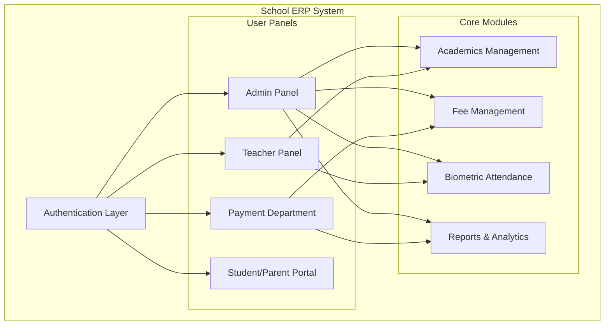
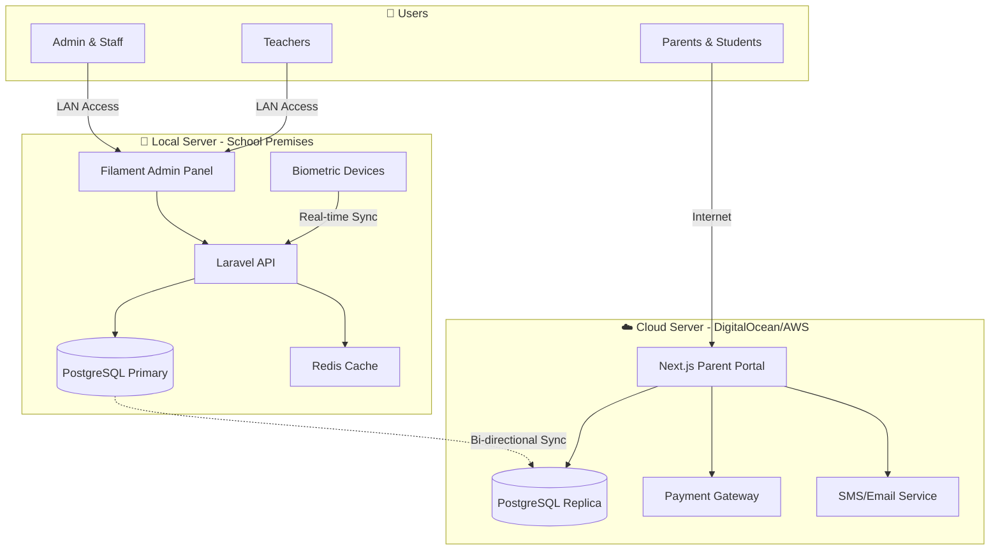
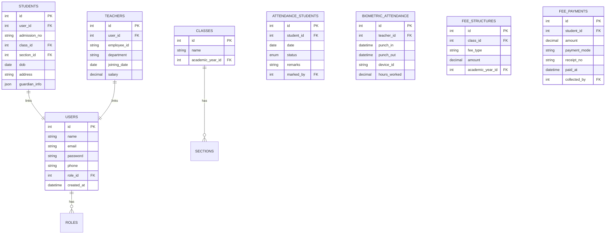

# School ERP System - Complete Feature Specification

A comprehensive Enterprise Resource Planning system designed specifically for educational institutions, featuring role-based panels for administrators, teachers, and payment departments with biometric attendance integration.

---

## 🏫 System Overview

---

## 👤 User Roles & Access Levels

| Role | Access Level | Description |
|------|-------------|-------------|
| **Super Admin** | Full System | Complete control over all modules and settings |
| **School Admin** | Administrative | Manage school operations, staff, and students |
| **Teacher** | Teaching Panel | Class management, grades, attendance marking |
| **Accountant** | Payment Dept | Fee collection, financial reports |
| **Student** | Limited Portal | View grades, attendance, fee status |
| **Parent** | Guardian Portal | Monitor child's progress, pay fees online |

---

## 🔐 1. Admin Panel Features

### 1.1 Dashboard
- Real-time school statistics (total students, teachers, revenue)
- Quick action buttons for common tasks
- Upcoming events calendar
- Pending approvals notifications
- System health and alerts

### 1.2 User Management
- Add/edit/deactivate staff accounts (teachers, accountants, admins)
- Bulk user import via Excel/CSV
- Password reset functionality
- Role and permission assignment
- User activity logs

### 1.3 Student Management
- **Student Registration**
  - Complete enrollment form with personal details
  - Guardian/parent information
  - Previous academic records upload
  - Medical information and emergency contacts
  - Photo upload with auto-resize
  
- **Class Assignment**
  - Assign students to classes/sections
  - Batch transfer between classes
  - Roll number generation (auto/manual)
  
- **Student Records**
  - Complete academic history
  - Disciplinary records
  - Transfer certificates generation
  - Student ID card printing

### 1.4 Academic Management
- **Class & Section Setup**
  - Create multiple classes (1st to 12th, or custom levels)
  - Sections per class (A, B, C, etc.)
  - Class capacity settings
  
- **Subject Management**
  - Core and elective subjects
  - Subject-teacher mapping
  - Credit hours and grading weights
  
- **Timetable Management**
  - Visual timetable builder (drag & drop)
  - Period duration settings
  - Teacher workload balancing
  - Conflict detection

### 1.5 Examination & Grading
- **Exam Setup**
  - Define exam types (Unit Test, Mid-term, Final)
  - Exam schedules and venues
  - Mark distribution configuration
  
- **Grade Configuration**
  - Custom grading scales (A+, A, B+, etc.)
  - Pass/fail thresholds
  - GPA calculation settings
  
- **Report Cards**
  - Customizable report card templates
  - Batch report generation
  - Digital and printable formats

### 1.6 Communication Hub
- Announcements (school-wide, class-specific)
- SMS/Email notifications
- Parent-teacher meeting scheduler
- Event management

### 1.7 Settings & Configuration
- School profile and branding
- Academic year setup
- Holiday calendar
- Fee structure templates
- Backup and restore

---

## 👨‍🏫 2. Teacher Panel Features

### 2.1 Teacher Dashboard
- Today's class schedule
- Pending tasks (attendance not marked, assignments to grade)
- Student performance overview
- Quick links to frequently used features

### 2.2 Class Management
- View assigned classes and subjects
- Student list with photos and details
- Class-wise student count
- Search and filter students

### 2.3 Attendance Management
- **Daily Attendance**
  - Mark attendance with single click (present/absent/late)
  - Bulk attendance marking
  - Leave request approvals
  - Attendance correction with reason
  
- **Attendance Reports**
  - Class-wise attendance summary
  - Student-wise attendance history
  - Monthly/weekly reports
  - Low attendance alerts

### 2.4 Gradebook & Assessments
- **Assignment Management**
  - Create and assign homework
  - Set due dates and marks
  - Online submission tracking
  - Grade assignments
  
- **Exam Marks Entry**
  - Enter marks for assigned subjects
  - Import marks from Excel
  - Auto-calculate totals and percentages
  - Submit for approval
  
- **Performance Analytics**
  - Class average comparisons
  - Subject-wise analysis
  - Progress tracking graphs

### 2.5 Lesson Planning
- Daily/weekly lesson plans
- Syllabus completion tracker
- Teaching notes upload
- Resource attachments

### 2.6 Communication
- Send messages to parents
- Class announcements
- Parent meeting requests
- Leave applications

### 2.7 Personal Profile
- Update contact information
- View salary slips
- Attendance record (self)
- Document uploads

---

## 💰 3. Payment Department Panel Features

### 3.1 Fee Dashboard
- Today's collection summary
- Pending fee overview
- Monthly/yearly collection charts
- Outstanding dues alerts

### 3.2 Fee Structure Management
- **Fee Categories**
  - Tuition fee
  - Admission fee
  - Transport fee
  - Lab fee
  - Library fee
  - Exam fee
  - Miscellaneous
  
- **Fee Templates**
  - Class-wise fee structures
  - Term-wise breakdown
  - Optional fees configuration
  - Sibling discounts

### 3.3 Fee Collection
- **Student Fee Status**
  - View complete fee history
  - Outstanding balance
  - Payment schedule
  
- **Payment Processing**
  - Multiple payment modes (Cash, Card, Online, Bank Transfer)
  - Partial payment handling
  - Receipt generation (print/email)
  - QR code payments
  
- **Late Fee Management**
  - Auto late fee calculation
  - Late fee waivers with approval
  - Penalty configuration

### 3.4 Scholarships & Discounts
- Scholarship types and eligibility
- Apply discounts to students
- Discount approval workflow
- Scholarship tracking

### 3.5 Financial Reports
- **Collection Reports**
  - Daily collection report
  - Class-wise collection
  - Payment mode analysis
  
- **Outstanding Reports**
  - Defaulters list
  - Ageing analysis
  - Class-wise pending dues
  
- **Analytics**
  - Monthly comparison charts
  - Trend analysis
  - Forecast projections

### 3.6 Fee Reminders
- Automated SMS/email reminders
- WhatsApp notifications integration
- Custom reminder scheduling
- Bulk reminder sending

### 3.7 Online Payment Integration
- Payment gateway integration (Razorpay/Stripe/PayU)
- Parent portal fee payment
- Transaction tracking
- Refund processing

---

## 🖐️ 4. Biometric Attendance System (Teachers)

### 4.1 Device Integration
- **Supported Devices**
  - Fingerprint scanners (ZKTeco, eSSL, Mantra)
  - Face recognition terminals
  - Card-based systems
  
- **API Integration**
  - Real-time sync with biometric devices
  - Push/pull attendance data
  - Multi-device support
  - Offline data handling

### 4.2 Attendance Features
- **Check-in/Check-out**
  - Automatic time recording
  - Multiple shift support
  - Grace period configuration
  - Early/late marking
  
- **Leave Management**
  - Leave application workflow
  - Leave balance tracking
  - Holiday integration
  - Compensatory off management
  
- **Work Hours**
  - Total hours calculation
  - Overtime tracking
  - Minimum attendance requirements

### 4.3 Reports & Analytics
- Daily attendance dashboard
- Monthly attendance sheets
- Punctuality analysis
- Absenteeism patterns
- Department-wise reports

### 4.4 Alerts & Notifications
- Real-time attendance alerts to admin
- Absentee notifications
- Late arrival warnings
- Weekly summary reports

---

## 📱 5. Student/Parent Portal

### 5.1 Dashboard
- Academic summary
- Attendance overview
- Upcoming exams/events
- Fee payment status

### 5.2 Academic Access
- View grades and progress
- Download report cards
- Assignment details
- Timetable view

### 5.3 Fee Management
- View fee structure
- Outstanding dues
- Online payment
- Download receipts

### 5.4 Communication
- View school announcements
- Message teachers
- PTM scheduling
- Complaint/suggestion box

---

## 🔧 6. Technical Architecture

### 6.1 Finalized Technology Stack ✅

| Layer | Technology | Justification |
|-------|------------|---------------|
| **Frontend** | Next.js 14+ with TypeScript | SSR support, excellent performance, React ecosystem |
| **Admin Panel** | Filament 3 (Laravel) | Rapid admin development, built-in CRUD |
| **Backend API** | Laravel 11 (PHP 8.3) | Built-in auth, queues, excellent ORM, easy hosting |
| **Database** | PostgreSQL 16 | ACID compliance, JSON support, complex queries |
| **Authentication** | Laravel Sanctum + JWT | Secure token-based auth for API and SPA |
| **File Storage** | Local (school) + AWS S3 (cloud) | Hybrid approach for performance |
| **Biometric API** | REST API with ZKTeco/eSSL SDK | Real-time attendance sync |
| **Payment Gateway** | TBD (Razorpay/Stripe) | Online fee payment |
| **Notifications** | Laravel Notifications + Twilio | SMS, Email, WhatsApp alerts |
| **Cache** | Redis | Session management, queue jobs |

### 6.2 Hybrid Hosting Architecture ✅

### 6.3 Hybrid Architecture Benefits

| Component | Location | Advantage |
|-----------|----------|-----------|
| **Admin Panel** | 🏫 Local | ⚡ Instant response, works without internet |
| **Teacher Panel** | 🏫 Local | ⚡ Fast attendance, no latency |
| **Biometric System** | 🏫 Local | 🔒 Secure, real-time sync |
| **Fee Collection (Staff)** | 🏫 Local | ⚡ Fast receipt printing |
| **Parent Portal** | ☁️ Cloud | 🌐 24/7 access from anywhere |
| **Online Fee Payment** | ☁️ Cloud | 💳 Payment gateway integration |
| **SMS/Email** | ☁️ Cloud | 📱 Better deliverability |
| **Backups** | ☁️ Cloud | 💾 Disaster recovery |

### 6.4 Data Synchronization Strategy

- **Real-time sync** for critical data (attendance marked, fee paid)
- **Scheduled sync** every 5 minutes for non-critical data
- **Conflict resolution** with timestamp-based last-write-wins
- **Offline capability** - local server fully operational without internet
- **Queue-based sync** using Laravel Horizon for reliability

### 6.5 Database Schema (Key Tables)

---

## 📋 7. Development Phases

### Phase 1: Foundation (Weeks 1-3)
- [ ] Project setup and architecture
- [ ] Database design and migrations
- [ ] Authentication system
- [ ] Basic admin dashboard

### Phase 2: Core Modules (Weeks 4-8)
- [ ] Student management module
- [ ] Teacher management module
- [ ] Class and section management
- [ ] Basic attendance system

### Phase 3: Academic Features (Weeks 9-12)
- [ ] Timetable management
- [ ] Examination and grading
- [ ] Report card generation
- [ ] Teacher panel completion

### Phase 4: Financial Modules (Weeks 13-16)
- [ ] Fee structure management
- [ ] Fee collection system
- [ ] Payment gateway integration
- [ ] Financial reports

### Phase 5: Advanced Features (Weeks 17-20)
- [ ] Biometric attendance integration
- [ ] Student/Parent portal
- [ ] Mobile app (optional)
- [ ] Advanced analytics

### Phase 6: Testing & Launch (Weeks 21-24)
- [ ] Comprehensive testing
- [ ] Bug fixes and optimization
- [ ] User training documentation
- [ ] Production deployment

---

## 🔒 8. Security Features

- Role-based access control (RBAC)
- Two-factor authentication (2FA)
- Data encryption at rest and in transit
- Regular automated backups
- Audit logging for all actions
- Session management and timeout
- Input validation and sanitization
- Protection against SQL injection, XSS, CSRF

---

## 📊 9. Reporting Capabilities

| Report Category | Reports |
|----------------|---------|
| **Academic** | Progress reports, Class performance, Subject analysis |
| **Attendance** | Student attendance, Teacher attendance, Monthly summaries |
| **Financial** | Collection reports, Outstanding dues, Fee defaulters |
| **Administrative** | Staff reports, Enrollment trends, Capacity utilization |

---

## User Review Required

### ✅ Confirmed Decisions

| Decision | Choice |
|----------|--------|
| Frontend | Next.js with TypeScript |
| Backend | Laravel 11 (PHP 8.3) |
| Database | PostgreSQL 16 |
| Hosting | Hybrid (Local + Cloud) |

### ⏳ Pending Decisions

> [!IMPORTANT]
> **Biometric Device**: Please specify the biometric device brand/model you plan to use for teacher attendance (ZKTeco, eSSL, Mantra, or other).

> [!IMPORTANT]
> **Payment Gateway**: Which payment gateway would you prefer for online fee payments? (Razorpay, Stripe, PayU, or others)

---

## Verification Plan

### Automated Tests
- Unit tests for all backend API endpoints
- Integration tests for payment gateway
- Authentication flow tests

### Manual Verification
- User role permission testing
- Full fee collection workflow walkthrough
- Biometric device integration testing
- Cross-browser UI testing
